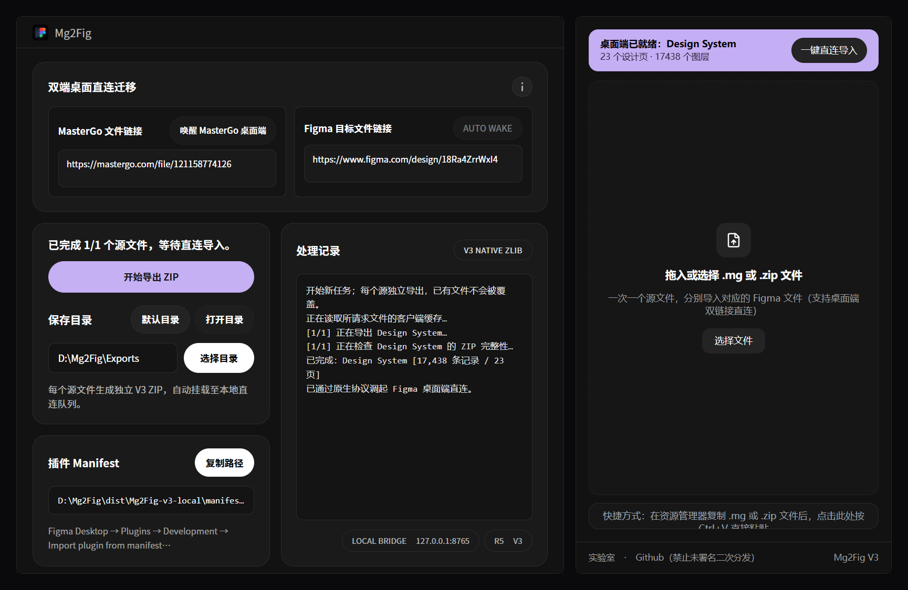

# Mg2Fig [R5 Desktop - V3 Pipeline]

将 MasterGo 设计文件迁移为 Figma 中可继续编辑的页面、图层、组件、自动布局与本地样式。提供 **Mg2Fig R5** Windows 桌面端直连工具与 **Mg2Fig V3** Figma 本地插件，支持双端链接原生协议唤醒、超大文件 V3 ZIP64 流式封包与一键直连导入。



**基于 [Aaron Xu [AaronXu-Lab]](https://github.com/AaronXu-Lab) 的 [MasterGo2Figma](https://github.com/AaronXu-Lab/MasterGo2Figma) 修改。** 上游基准为 [`d6d93574b1c695906300d60712697a03b795877e`](https://github.com/AaronXu-Lab/MasterGo2Figma/commit/d6d93574b1c695906300d60712697a03b795877e)。Mg2Fig 构建了 R5 双端桌面直连工作台、V3 原生 zlib/ZIP64 高速压缩管线、跨页组件依赖闭环、按需分片流式导入、字体超时降级与失败内容保留机制；不是上游官方发行版，也不表示原作者为本项目背书。

本项目沿用 **[CC BY-NC-SA 4.0](LICENSE)**：署名、非商业性使用、相同方式共享。完整来源与第三方声明见 [ATTRIBUTION.md](ATTRIBUTION.md)。

## 核心更新 [R5 - V3]

- **双端桌面原生直连 [R5]** - 填入 MasterGo 源链接与 Figma 目标链接后，桌面端通过 `mastergo://` 与 `figma://` 原生协议直接唤醒本地客户端，并在 `127.0.0.1:8765` 挂载本地直连队列，无需手动中转文件。
- **V3 原生高速封包与超 2 GiB ZIP64 管线** - 底层移除外部子进程逐张图片重解析与整包内存缓冲，改用 Node.js 原生 C++ `zlib` + 纯 JS 图片头部快速探测 + 流式 `SHA-256` / `CRC-32` 写出与分段文件描述符校验，支持 4 GB 以上超大设计包秒级校验与按范围流式读取。
- **实例精简与跨页组件闭环** - 自动收集跨页主组件与变体集依赖，实例子层采用精简增量传输并在接收端按拓扑顺序还原，大幅降低内存峰值与传输耗时。
- **非阻塞字体预检与保留式容错** - 针对本地无响应或缺失的中文字体执行单字体 5 秒超时自动降级与 `[Font Missing]` 标记，不中断整场导入；导入异常中断时完整保留已完成页面与有效节点。

## 下载与快速运行

从 [Releases](https://github.com/7ochard/M2Fig/releases) 下载完整的 **Windows x64 ZIP**。解压后保留完整工程目录；桌面程序依赖同目录源码与本机运行时，请勿单独复制 EXE 到其他目录。

当前验证环境为 Windows、Node.js 24、Python 3.13。首次使用流程：

1. 安装 Node.js 24 与 Python 3.13 [包含 pip]。
2. 双击 `SetupM2Fig.cmd`，初始化导出依赖并生成本机运行配置 [首次安装需联网]。
3. 在已登录的 MasterGo 桌面客户端打开源文件一次，等待完整加载以生成本地缓存快照。
4. 启动 `Mg2Fig.exe`，填入 MasterGo 文件链接与可选的 Figma 目标文件链接，选择保存目录后点击 **开始导出 ZIP**。
5. 在 Figma Desktop 打开目标设计文件，依次选择 **Plugins -> Development -> Import plugin from manifest...**，载入 `dist/Mg2Fig-v3-local/manifest.json`。
6. 运行 **Mg2Fig V3** 插件，点击顶部 **一键直连导入** 横幅，或直接拖入导出的 `.zip` / `.mg` 文件完成导入。

**一个源文件对应一个独立设计 ZIP、一个 Figma 文件。** 已有原生 `.mg` 文件时，也可直接拖入 Figma 插件窗口解析导入。

## 能力与边界

- 保留可恢复的可编辑图层、自动布局、组件与实例覆盖关系及本地样式；跨页引用自动补齐至依赖页。
- 支持超过 2 GiB / 4 GiB 的 ZIP64 大型迁移包，插件端通过本地字节范围接口按需流式读取条目，避免前端内存溢出。
- 导入中断后保留已完成页面和有效节点，报告区分完成、部分保留与未开始；继续前应核对部分页，避免重复导入。
- 桌面链接用于定位**本机 MasterGo 缓存快照**，不是云端下载接口；无本机缓存时需先在 MasterGo 桌面端打开并加载。
- 不自动新建或重命名 Figma 云端文件，不生成 `.fig`，不做实时同步；不迁移变量绑定与原型交互。
- 字体、缺失源数据及两端渲染引擎差异会影响视觉结果，不承诺逐像素完全一致。

详细说明见 [公开使用指南](docs/public/USAGE.md)，标准迁移步骤见 [SOP](docs/public/SOP.md)。

## 开发与构建

依赖分别安装在两个插件和桌面目录，使用各自 lockfile：

```powershell
npm ci --prefix ReceiveFromMasterGo
npm ci --prefix SendToFigma
npm ci --prefix desktop
python -m pip install -r requirements.txt

node --test tools/tests/*.test.js
npm test --prefix desktop
npm run build --prefix ReceiveFromMasterGo
npm run build --prefix SendToFigma
```

插件 UI 源码位于 `ReceiveFromMasterGo/ui-src/`，请勿直接手改生成的 `ui.html`。桌面端界面位于 `desktop/renderer/`。

```powershell
# 生成 Mg2Fig V3 Figma 与 MasterGo 插件分发包
powershell -NoProfile -ExecutionPolicy Bypass -File tools/packageMg2FigV3.ps1

# 构建 Mg2Fig R5 桌面端 EXE [输出至 dist/desktop-v3/Mg2Fig.exe 并同步根入口]
powershell -NoProfile -ExecutionPolicy Bypass -File tools/buildDesktopMg2FigV3.ps1
```

首次配置、构建及打包说明见 [本地 GUI 指南](docs/public/LOCAL_EXPORT_GUI.md)。本仓库不包含用户私有设计、真实业务链接、客户端缓存、依赖目录或本机运行配置；回归测试均使用合成数据。

## 署名

- **Aaron Xu / AaronXu-Lab** - MasterGo2Figma 原作者，提供原生 `.mg` 解析、两端序列化与图层恢复的核心基础。
- **Mg2Fig contributors** - R5 双端桌面直连工作台、V3 原生压缩与大文件流式管线、失败保留、性能诊断与界面重构。
- 图片解码、React、Electron、Radix、shadcn/ui、Lucide 等依赖各自保留许可证和作者信息，见 [ATTRIBUTION.md](ATTRIBUTION.md) 与 [插件第三方声明](ReceiveFromMasterGo/THIRD_PARTY_NOTICES.md)。
